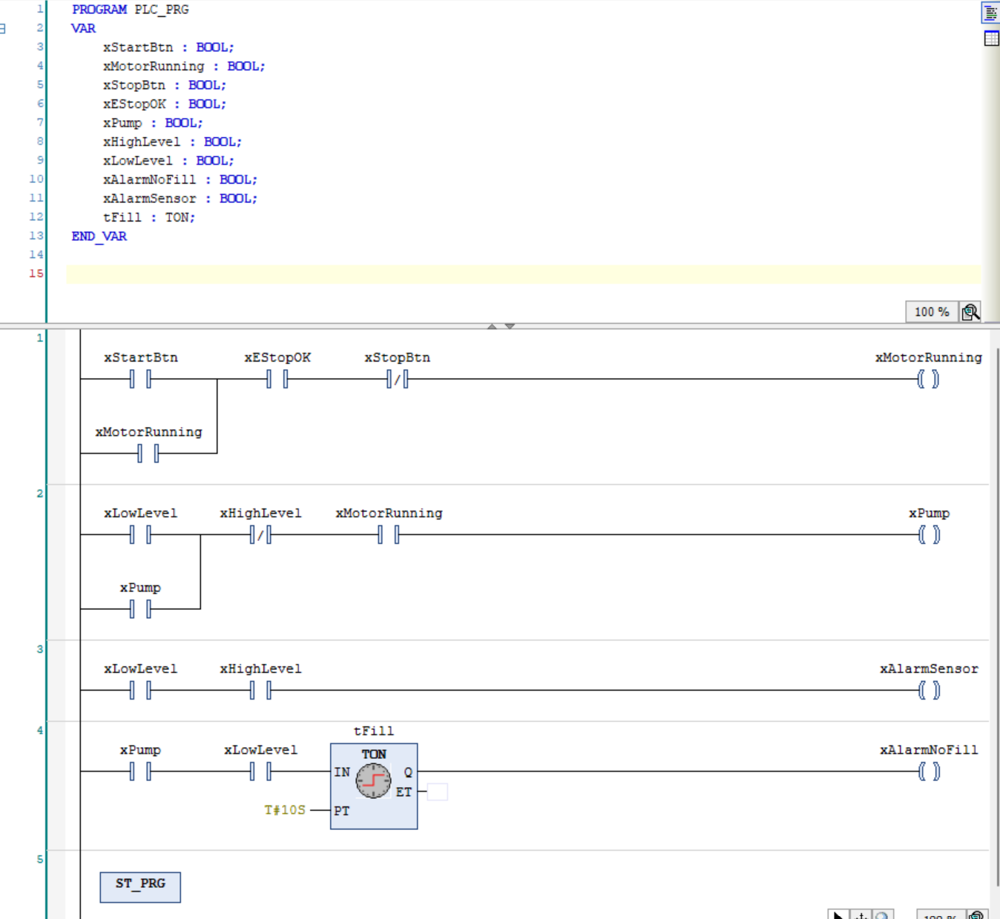
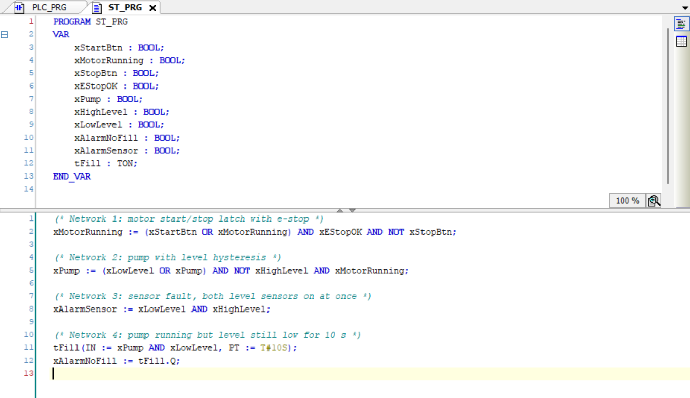
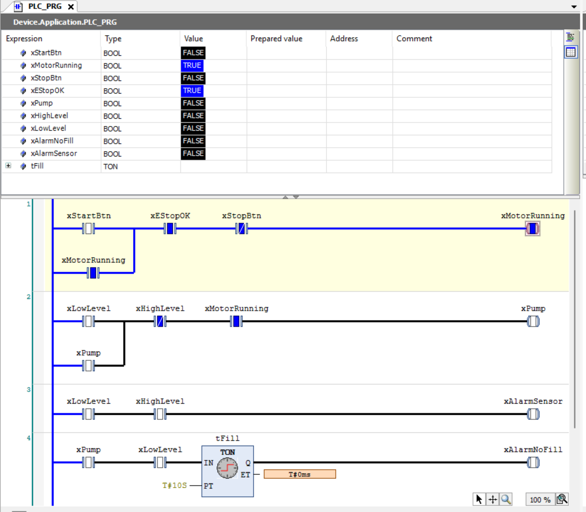
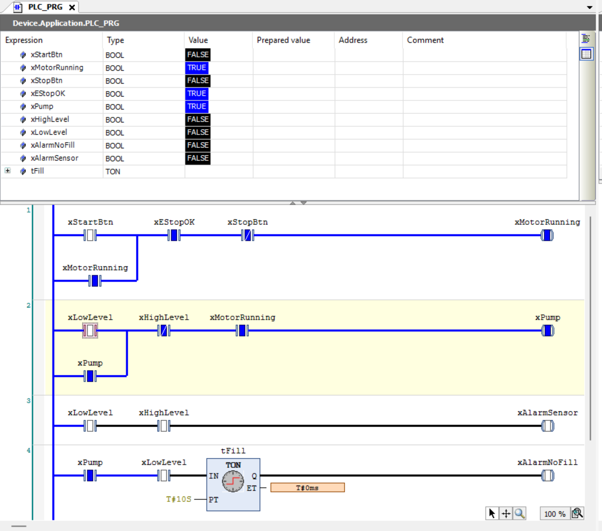
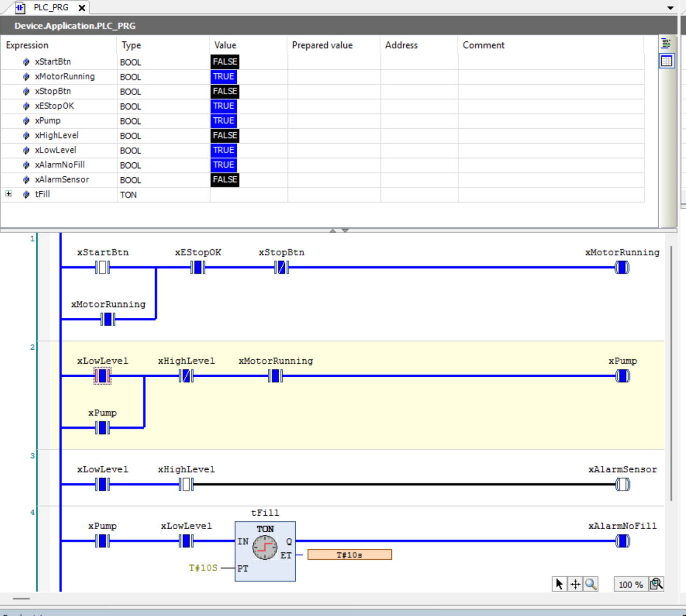
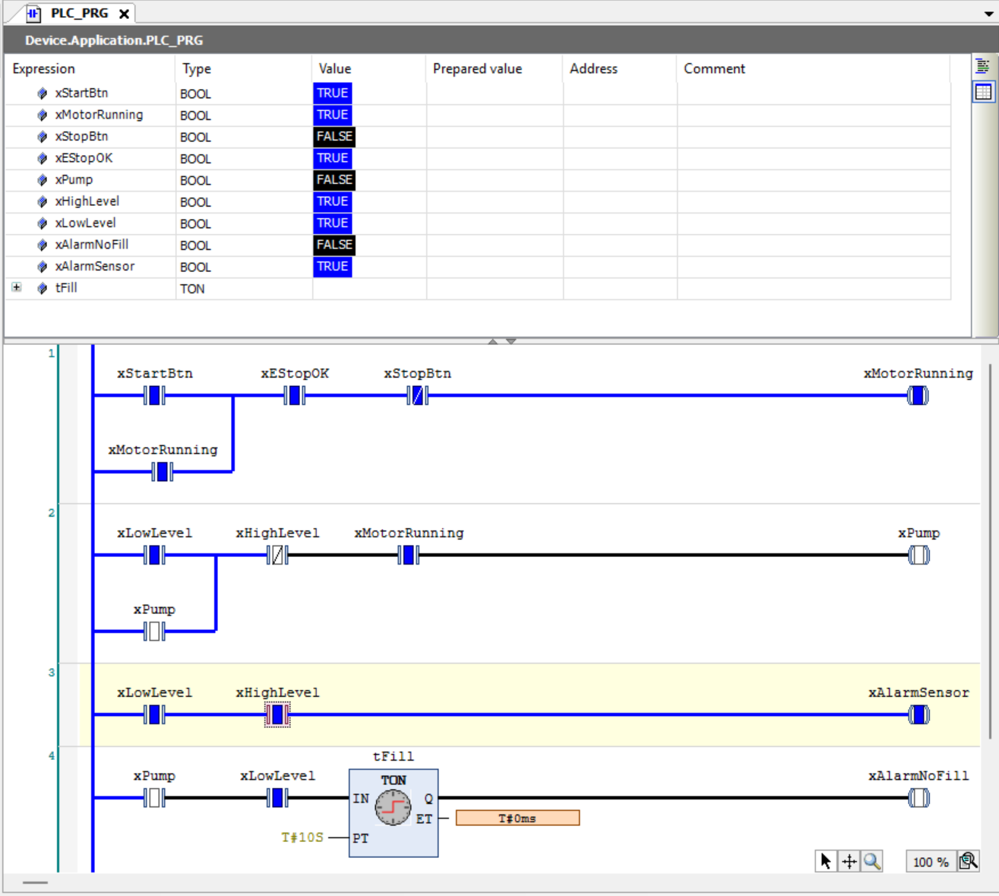

# PLC Level Controller
 
A small learning project in CODESYS: a tank-filling controller with a start/stop latch, an emergency stop, level-based pump control with hysteresis, and two alarms. It is written twice, in ladder logic (LD) and in structured text (ST), and tested in the CODESYS soft PLC simulation.
 
This is a simulation-only project. There is no hardware, and the level sensors are on/off signals set by hand in the watch list.
 
## What it does
 
- **Motor enable (start/stop latch).** START turns the system on and it stays on after START is released. STOP turns it off.
- **Emergency stop.** If the e-stop circuit is not healthy, the system drops out. It does not restart on its own when the e-stop is restored, START has to be pressed again.
- **Pump control with hysteresis.** The pump starts when the tank is low and keeps running until the tank is full. It only runs while the system is enabled.
- **Sensor fault alarm.** If the low-level and high-level sensors are on at the same time, one of them must be faulty, so an alarm is raised.
- **No-fill alarm.** If the pump has been running with the level still low for 10 seconds, an alarm is raised (for example a dry pump or a blocked pipe).
## Tools
 
- CODESYS Development System with the built-in soft PLC (simulation)
- IEC 61131-3 languages: Ladder Diagram (LD) and Structured Text (ST)
## Inputs and outputs
 
| Name | Type | Direction | Meaning |
|---|---|---|---|
| `xStartBtn` | BOOL | Input | START push button |
| `xStopBtn` | BOOL | Input | STOP push button, used as a normally-closed contact |
| `xEStopOK` | BOOL | Input | TRUE when the e-stop circuit is healthy (fail-safe: a broken wire reads FALSE) |
| `xLowLevel` | BOOL | Input | Low-level sensor, TRUE when the tank is low |
| `xHighLevel` | BOOL | Input | High-level sensor, TRUE when the tank is full |
| `xMotorRunning` | BOOL | Internal | System enabled (latch) |
| `xPump` | BOOL | Output | Pump |
| `xAlarmSensor` | BOOL | Output | Sensor fault alarm |
| `xAlarmNoFill` | BOOL | Output | Pump running but level not rising |
| `tFill` | TON | Internal | 10 s on-delay timer for the no-fill alarm |
 
## Logic
 
The program has four networks, evaluated top to bottom every scan.
 
| Network | Purpose | Structured text |
|---|---|---|
| 1 | Start/stop latch with e-stop | `xMotorRunning := (xStartBtn OR xMotorRunning) AND xEStopOK AND NOT xStopBtn;` |
| 2 | Pump with hysteresis | `xPump := (xLowLevel OR xPump) AND NOT xHighLevel AND xMotorRunning;` |
| 3 | Sensor fault | `xAlarmSensor := xLowLevel AND xHighLevel;` |
| 4 | No-fill alarm | `tFill(IN := xPump AND xLowLevel, PT := T#10S); xAlarmNoFill := tFill.Q;` |
 
How it works:
 
- **Seal-in latch.** The output contact is placed in parallel with the START contact, so the rung keeps itself on after START is released.
- **Hysteresis.** The pump has two thresholds: it turns on at low level and turns off at high level. Between the two it holds its previous state through its own seal-in contact, so it does not switch on and off around a single level.
- **Fail-safe e-stop.** `xEStopOK` is TRUE when healthy, so a broken wire or a pressed e-stop both open the rung.
- **Timer.** The TON only counts while its input stays TRUE. If the level rises before 10 s, the timer resets and no alarm is raised.
- **One coil per variable.** Each output is written in exactly one place, so no two networks fight over the same variable.
## Screenshots
 
**Full ladder program (LD)**
 

 
**Structured text version (ST)**
 

 
**Latch holding after START is released** (`xStartBtn` FALSE, `xMotorRunning` still TRUE)
 

 
**Hysteresis: pump stays on between the two levels** (`xLowLevel` and `xHighLevel` both FALSE, `xPump` still TRUE)
 

 
**No-fill alarm after 10 s** (`tFill` reached `T#10s`, `xAlarmNoFill` TRUE)
 

 
**Sensor fault alarm** (both level sensors TRUE, pump blocked)
 

 
## Test results
 
Tested in the CODESYS simulation. Before the tests, `xEStopOK` is set to TRUE. Values were written with Ctrl+F7 (not forced).
 
| # | Action | Expected | Result |
|---|---|---|---|
| 1 | Press START (TRUE then FALSE) | `xMotorRunning` on and stays on | Pass |
| 2 | Press STOP | `xMotorRunning` off, stays off after release | Pass |
| 3 | START, then `xEStopOK` FALSE | `xMotorRunning` off | Pass |
| 4 | `xEStopOK` TRUE again | Stays off until START is pressed | Pass |
| 5 | START, `xLowLevel` TRUE then FALSE | `xPump` on, stays on | Pass |
| 6 | `xHighLevel` TRUE | `xPump` off | Pass |
| 7 | `xLowLevel` TRUE, then STOP | `xPump` off | Pass |
| 8 | `xLowLevel` and `xHighLevel` both TRUE | `xAlarmSensor` on | Pass |
| 9 | Pump on, `xLowLevel` TRUE for 10 s | `xAlarmNoFill` on after 10 s | Pass |
| 10 | Same, but `xLowLevel` FALSE after 3 s | Timer resets, no alarm | Pass |
 
The structured text version was run as a separate program and showed the same behaviour as the ladder version.
 
## How to run
 
1. Open the project in CODESYS.
2. Select **Online, then Simulation**, then **Online, then Login**, and download.
3. Start with **Online, then Start** (F5).
4. Open `PLC_PRG` (ladder) or `ST_PRG` (structured text) and use the watch list to set inputs. Double-click the **Prepared value** cell to toggle a value and press **Ctrl+F7** to write it. Set `xEStopOK` to TRUE first.
## Files
 
- `TankLevelController.project`: CODESYS project (ladder program `PLC_PRG` and structured text program `ST_PRG`)
- `images/`: screenshots used above
## What I learned
 
- How a PLC scan cycle works: read inputs, run the program top to bottom, write outputs.
- Building latches, hysteresis and timer-based alarms in ladder logic and structured text.
- Designing fail-safe logic (normally-closed stop contacts, an e-stop that does not auto-restart).
- Debugging with the online watch list, forced versus written values, and avoiding duplicate coils.
## Limitations and next steps
 
- The level is simulated with two on/off sensors, not a real or analogue measurement.
- Next step: use an analogue level value with setpoints and add a PID loop.
- Next step: share variables between the ladder and structured text programs through a Global Variable List.
- Next step: add a Modbus TCP link to a small Python simulation of the tank.
